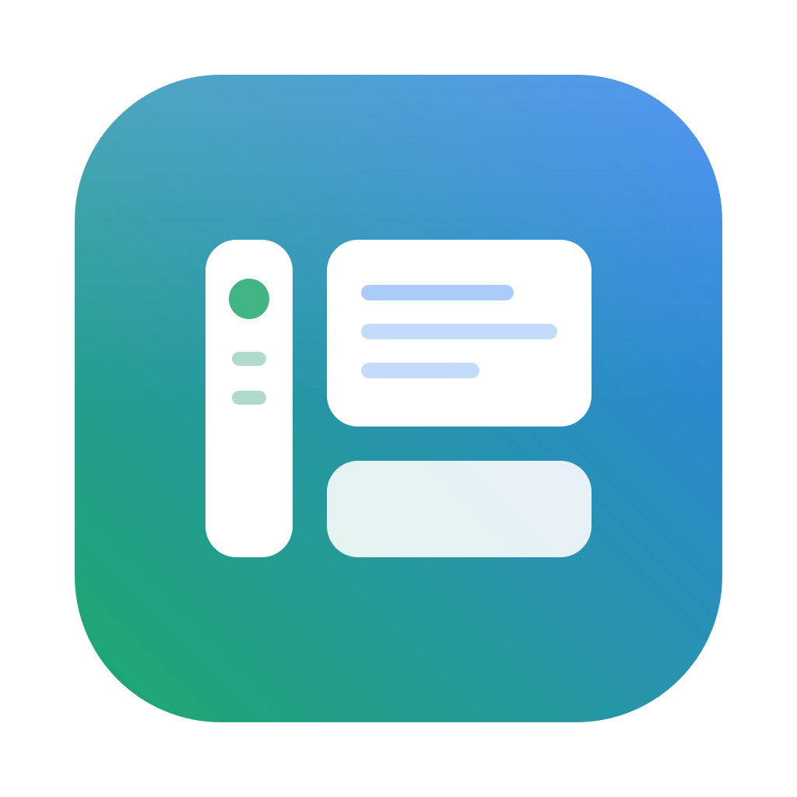

<div align="center">
  
  <h1>worktop</h1>
  <p><strong>你的 AI，与你的电脑一起工作。</strong></p>
  <p>对话 · 文件 · 终端 · 网页 · 应用 · 小组件</p>
  <p>iimos 的一个形态：标签页 + 分屏的个人 AI 工作台。</p>
  <p>
    <a href="https://iimos.ai/s/worktop">在 iimos.ai 上换上它</a> ·
    <a href="#开始使用">开始使用</a> ·
    <a href="#开发与构建">开发与构建</a> ·
    <a href="https://github.com/yanglongyun/worktop/issues">反馈与建议</a> ·
    <a href="LICENSE">MIT License</a>
  </p>
</div>

---

worktop 是 [iimos](https://iimos.ai)（一个可以改自己的 Agent 客户端）的一个**形态**：这个仓库就是一份可改的源码，
换上之后它跑在 iimos 的 launcher 里。你可以和 AI 讨论想法，也可以让它读写文件、执行命令、操作网页，或为自己制作一个应用和小组件——
包括修改 worktop 自己。

对话、文件、终端、网页和应用在同一个窗口中打开，通过**标签页与左右分屏**并排查看。文件保存在你的电脑上，AI 生成的成果可以直接打开、编辑和继续使用。

<p align="center"></p>

## 在一个窗口里，完成一件事

| 能力 | 你可以做什么 |
| --- | --- |
| **与 AI 协作** | 流式对话，查看思考与工具执行过程；长对话自动压缩上下文，保留交接摘要 |
| **处理本地文件** | 浏览常用文件夹、编辑代码，预览 Markdown、HTML、图片和 PDF |
| **使用浏览器** | 收藏和打开网站；AI 通过 iimos 浏览器插件操作你自己的 Chrome / Edge（带你的登录态） |
| **运行终端** | 使用交互式终端，让 AI 执行命令；通过 Git 面板查看仓库变化 |
| **扩展应用** | 安装本地应用，让 AI 通过应用提供的接口处理任务 |
| **制作小组件** | 把记账、打卡、数据查看等需求做成自己的侧栏工具 |

从一句话开始：

> “读一下这份项目代码，告诉我它是怎么组织的。”
>
> “把这些资料整理成一份能打开查看的 HTML 报告。”
>
> “给我做一个喝水打卡的小组件。”

## 界面一览

| | |
| --- | --- |
|  |  |
| 一句话交给它：读文件、跑命令、写文件 | 新标签页：对话 / 网址 / 命令三种模式 |
|  |  |
| 内置应用「创意」：一个想法发散成多个方向 | 终端就是终端，Codex / Claude Code 直接跑 |

## 从对话开始，自然使用电脑

**不用先选一个工作区。** 新建对话打开空白起始页，发送第一条消息时才创建对话记录。文件面板只是常用目录的入口，浏览哪个文件夹不会绑定对话。

**按任务找到文件。** 文件工具支持绝对路径与 `~/`；终端默认从用户主目录启动，执行命令时可以指定目录。你指定的保存位置优先，未指定的新文件可放在 `~/worktop/outputs/<对话ID>/`，需要写入时才创建目录。

**把能力交给 AI，把偏好留给自己。** 在设置中配置模型、助手指令、压缩提示词与操作规则。启用的技能按需读取，应用和小组件可以继续扩展工作台的能力。

> **运行边界**：worktop 仍在开发中。命令与文件工具直接作用于本机，没有沙箱隔离；操作规则用于约束助手行为，不替代系统级隔离。模型请求发送到你配置的服务，请按任务需要选择模型与授权范围。

## 开始使用

**换上这个形态**：安装 [iimos](https://iimos.ai)，让它去 [iimos.ai/s/worktop](https://iimos.ai/s/worktop) 换上 worktop（在对话里说一句就行）。
launcher 负责启动、快照和回滚；worktop 的源码就在它的 workspace 里，之后想改什么，继续在对话里说。

**在 iimos 的仓库里直接跑这份源码**（开发用）：

```bash
git clone https://github.com/yanglongyun/worktop.git
cd iimos/client && IIMOS_SEED=../../worktop IIMOS_HOME=/tmp/iimos-worktop npm run app
```

启动后：

1. 打开**设置 → 模型**，填写 API URL、API Key 和 Model。接口需要兼容 **Responses API**（配置写在 `$IIMOS_DATA/config.json`，所有形态共用）。
2. 查看**助手指令**和**规则**，按自己的使用习惯调整。
3. 点击**新建对话**，描述你想完成的事情；也可以添加文件作为上下文。

AI 操作网页要在 Chrome / Edge 里加载 iimos 的浏览器插件（iimos 仓库 `extension/`）。

## 开发与构建

形态在用户机器上没有 npm：服务端打成 `dist/server.mjs`、界面编成 `ui/dist/`、第三方库放在 `ui/vendor/`，三样都进 git。
改了源码，在 iimos 里 `iimos reload`（只改 ui/）或 `iimos restart`（改了 server/，main.js 会用 launcher 的 esbuild 自动重打服务端）。

开发机上：

```bash
npm install
npm run build        # Tailwind + 服务端 + 界面
npm test
```

| 命令 | 用途 |
| --- | --- |
| `npm run build:css` | Tailwind 源 `ui/src/styles.css` → `ui/src/styles.built.css`（用户机器上没有 Tailwind，产物进 git） |
| `npm run build:server` | `server/` → `dist/server.mjs` |
| `npm run build:ui` | `ui/src` → `ui/dist`（和 `iimos build` 同一套选项） |
| `npm run vendor:codemirror` | 把 CodeMirror 打成一个 vendor 文件（见 `ui/vendor-src/`）；其他前端库用 `iimos add` |
| `npm run typecheck` | 检查 TypeScript 类型 |
| `npm start` | 不经 launcher 起本地服务（没有终端和浏览器工具，地址打在终端里） |

结构、约定和踩过的坑见 [AGENT.md](AGENT.md)——它也是 worktop 里的 AI 每轮都会读的那份说明。

## 为自己扩展工作台

**应用**是带界面的本地网站，可以提供 HTTP API，让 AI 直接使用它的能力。宿主负责启动应用，并提供受权限约束的模型调用、任务与通知等接口。

**小组件**是侧栏里的轻量工具，使用 HTML、JavaScript 和 CSS，无需构建即可加载。每个组件拥有独立的本地来源，可以通过宿主接口使用 SQLite、模型和网络能力。

**技能**描述如何完成某类任务。AI 在需要时读取 `SKILL.md`，设置中的技能列表也可以直接打开说明文档。

制作小组件的完整约定见仓库内的 [widget 技能](resources/skills/widget/SKILL.md)。

<details>
<summary><strong>本地文件与数据目录</strong></summary>

用户文件保留在实际保存位置。SQLite 保存对话、消息、压缩记录、设置、收藏等结构化数据；应用和组件可以拥有自己的数据。
数据全在 launcher 给的 `$IIMOS_DATA` 下，回滚形态不会动它：

```text
$IIMOS_DATA/
├── config.json            模型配置（responsesUrl / apiKey / model），所有形态共用
└── worktop/
    ├── database/          SQLite
    ├── apps/              本地应用（.data/ 是应用数据）
    ├── widgets/           侧栏小组件
    ├── skills/            技能说明
    ├── files/ favicons/ logs/
    └── port.json          上次用的端口（界面偏好按 origin 存，端口要稳定）

~/worktop/outputs/          未指定位置时的对话产物
```

不经 launcher 跑时用 `WORKTOP_HOME`（默认 `~/.worktop`）；应用、组件和技能的根目录可通过 `WORKTOP_PRODUCT_HOME` 单独指定。

</details>

<details>
<summary><strong>接口分工</strong></summary>

| 前缀 | 调用方 | 作用 |
| --- | --- | --- |
| `/api/*` | worktop 主界面 | 管理对话、文件、网站、设置、应用与组件（认启动时的令牌 Cookie） |
| `/apps/*` | 应用 | 通过 `HOST_URL`、`APP_TOKEN` 与声明的权限访问宿主能力 |
| `/widgets/*` | 小组件 | 在组件自己的来源下访问同源宿主接口 |

主界面 API 按 `chats`、`files`、`browser`、`apps`、`widgets`、`skills`、`settings`、`system`、`git` 分组。WebSocket 为 `/api/ws`，健康检查为 `/health`。

应用自身的业务接口由应用定义，与宿主管理接口分开。

</details>

<details>
<summary><strong>源码结构</strong></summary>

```text
main.js                    形态入口：起服务，向 launcher 报到
dist/server.mjs            服务端打包产物
ui/src/
├── api/                   按业务划分的请求与类型
└── components/            活动栏、侧栏、标签页、分屏与功能界面
server/
├── agent/                 模型与工具循环、上下文压缩、工具实现
├── ai/                    模型协议、请求、读流与重试
├── chats/                 对话、消息、轮次、提示词与确认
├── database/              SQLite 连接、表与索引
├── http/                  HTTP API、WebSocket 与静态资源
├── files/                 文件树、常用目录、附件与监听
├── browser/               收藏、历史与密码
├── apps/                  应用注册、进程、宿主能力与任务
├── widgets/               组件注册、站点与宿主能力
├── skills/                技能注册与文档解析
├── settings/              设置、默认提示词与规则
├── terminals/             交互式终端（伪终端由 launcher 提供）与后台命令
├── git/                   Git 操作
├── system/                运行路径与系统集成
├── iimos.ts               launcher 能力入口（终端、文件框、通知、浏览器）
└── shared/                前后端共用事件契约
resources/                 内置应用、技能等资源
```

Agent 循环接收组装好的模型输入和工具，不依赖对话存储。对话层负责持久化消息、恢复上下文和向界面广播事件；HTTP 层按业务调用对应模块。

</details>

## 技术栈

**Electron · React · TypeScript · Node.js · SQLite**

界面使用 Tailwind CSS 与 Vite，代码编辑使用 CodeMirror，终端使用 xterm.js 与 node-pty。SQLite 由 Node.js 内置模块提供，无需部署外部数据库服务。

## 参与与反馈

欢迎通过 [Issues](https://github.com/yanglongyun/worktop/issues) 提交问题和建议。报告问题时，请附上系统版本、复现步骤和相关日志，并移除 API Key 等敏感信息。

提交代码前，请运行与改动相关的检查。涉及交互调整时，附上截图或简短操作说明，便于理解变化。

## License

[MIT](LICENSE) © 2026 realuckyang
